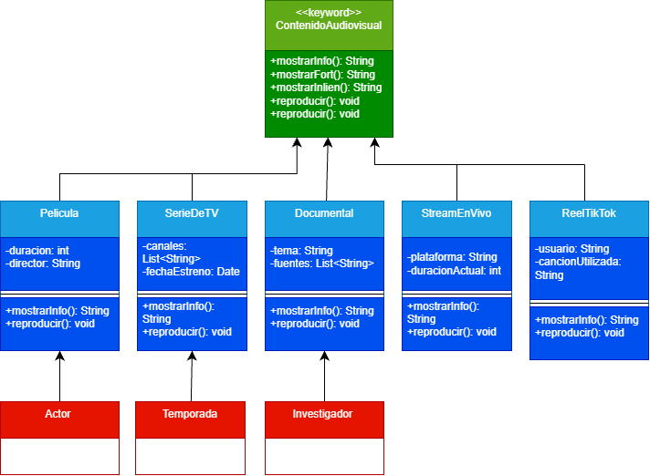

# Sistema de Gestión de Contenido Audiovisual

## 1. Descripción del Proyecto
Este proyecto es una aplicación desarrollada en Java aplicando los principios de la **Programación Orientada a Objetos (POO)**. Su propósito es gestionar de forma estructurada diferentes tipos de contenidos audiovisuales (películas, series de televisión, documentales, streams en vivo y reels de TikTok), permitiendo visualizar sus atributos y ejecutar funcionalidades de reproducción e información.

### Clases principales añadidas:
* **`ContenidoAudiovisual`**: Clase abstracta base que centraliza los métodos comunes de reproducción e información.
* **Subclases**: `Pelicula`, `SerieDeTV`, `Documental`, `StreamEnVivo` y `ReelTikTok`.
* **Clases de soporte y asociaciones**: `Actor` (relacionado con películas), `Temporada` (relacionado con series) e `Investigador` (relacionado con documentales).

---

## 2. Diagrama de Clases UML


---

## 3. Estructura de Carpetas
El repositorio está organizado de la siguiente manera:
* `poo-unidad2/`: Carpeta que contiene el código fuente Java del proyecto.
* `Diagrama_Clases_Audiovisual.png`: Imagen del diseño de clases UML del sistema.

---

## 4. Instrucciones de Clonación y Uso
Para clonar y ejecutar este proyecto localmente, abre tu terminal y ejecuta los siguientes comandos:

```bash
# Clonar el repositorio
git clone https://github.com/arielfranciscoorralacedeno-bit/Proyecto-Audiovisual_POO_U1.git
# Entrar a la carpeta del proyecto
cd Proyecto-Audiovisual_POO_U1
